# LAB 5 – Thiết lập mô hình tường lửa pfSense

Báo cáo thực hành môn **An toàn hệ thống thông tin** – Bộ môn An toàn Thông tin.

## Thông tin sinh viên

| Thông tin | Nội dung |
| :-- | :-- |
| Họ và tên | Huỳnh Hữu Hoàng |
| MSSV | 1150080095 |
| Lớp | 11CNPM2 |
| Giảng viên | Phạm Trọng Huynh |
| Ngày thực hiện | 06/10/2026 |
| File báo cáo | [11CNPM2-LAB5_1150080095-HuynhHuuHoang.docx](11CNPM2-LAB5_1150080095-HuynhHuuHoang.docx) |
| Video thực hành | https://youtu.be/bqY5bUrXBVY |

## Video thực hành

[](https://youtu.be/bqY5bUrXBVY)

Xem trên YouTube: [https://youtu.be/bqY5bUrXBVY](https://youtu.be/bqY5bUrXBVY)

## Mục lục

1. [Mục tiêu bài lab](#1-mục-tiêu-bài-lab)
2. [Môi trường và mô hình mạng](#2-môi-trường-và-mô-hình-mạng)
3. [Tóm tắt kết quả](#3-tóm-tắt-kết-quả)
4. [Quá trình thực hiện và ảnh minh chứng](#4-quá-trình-thực-hiện-và-ảnh-minh-chứng)
   - [4.1. Kiểm tra máy thật và chuẩn bị mạng VMware](#41-kiểm-tra-máy-thật-và-chuẩn-bị-mạng-vmware)
   - [4.2. Tạo máy ảo pfSense và kiểm tra bộ cài](#42-tạo-máy-ảo-pfsense-và-kiểm-tra-bộ-cài)
   - [4.3. Cài đặt pfSense](#43-cài-đặt-pfsense)
   - [4.4. Gán interface và đặt IP LAN trên console](#44-gán-interface-và-đặt-ip-lan-trên-console)
   - [4.5. Dựng Domain Controller vietnam.local](#45-dựng-domain-controller-vietnamlocal)
   - [4.6. Truy cập WebGUI và chạy Setup Wizard](#46-truy-cập-webgui-và-chạy-setup-wizard)
   - [4.7. Cấu hình vùng DMZ và máy DMZ-Web](#47-cấu-hình-vùng-dmz-và-máy-dmz-web)
   - [4.8. Kiểm tra Outbound NAT tự động](#48-kiểm-tra-outbound-nat-tự-động)
   - [4.9. Chuẩn hóa ruleset LAN và tạo rule nền tảng](#49-chuẩn-hóa-ruleset-lan-và-tạo-rule-nền-tảng)
   - [4.10. Kiểm thử rule nền tảng từ Domain Controller](#410-kiểm-thử-rule-nền-tảng-từ-domain-controller)
   - [4.11. Máy LAN-Test](#411-máy-lan-test)
5. [Trả lời câu hỏi](#5-trả-lời-câu-hỏi)
6. [Mức độ hoàn thành](#6-mức-độ-hoàn-thành)
7. [Cấu trúc thư mục](#7-cấu-trúc-thư-mục)
8. [Ghi chú](#8-ghi-chú)

## 1. Mục tiêu bài lab

- Xây dựng mô hình mạng có tường lửa pfSense bảo vệ LAN và vùng DMZ.
- Cấu hình WAN, LAN, DMZ, NAT và firewall rule.
- Dùng Windows Server làm máy trong LAN để kiểm thử lưu lượng.
- Thực hành nhiều tình huống firewall thay vì chỉ tạo một rule đơn giản.

## 2. Môi trường và mô hình mạng

| Thành phần | Thực tế |
| :-- | :-- |
| Máy thật | Windows 11, Intel Core i5-11400H, RAM 8 GB; ra Internet qua Wi-Fi 192.168.1.0/24 (gateway 192.168.1.1) |
| Ảo hóa | VMware Workstation 26 (tài liệu gốc viết cho VirtualBox, đã ánh xạ sang mạng tương đương) |
| Firewall | pfSense CE 2.7.2-RELEASE (amd64), hostname `pfSense-1150080095`; 1 GB RAM, 2 vCPU, ổ 20 GB, 3 card e1000 |
| Domain Controller | Windows Server 2025 Standard Evaluation – 10.0.0.2/8, domain `vietnam.local`, DNS forwarder 8.8.8.8 |
| DMZ-Web | Windows Server 2025 (clone từ bản mới cài, chưa promote, không join domain) – 172.16.0.2/16, chạy IIS |
| Bộ cài | `pfSense-CE-2.7.2-RELEASE-amd64.iso.gz` từ mirror Netgate, SHA-256 `883fb7bc…cd9e4` khớp |

**Ánh xạ card mạng từ VirtualBox sang VMware:**

| Card pfSense | Tài liệu (VirtualBox) | Thực tế (VMware) |
| :-- | :-- | :-- |
| Adapter 1 – WAN (em0) | Bridged Adapter | Bridged – VMnet0 bridge thẳng vào card Wi-Fi |
| Adapter 2 – LAN (em1) | Host-only, máy thật 10.0.0.100/8, tắt DHCP | Custom VMnet10 (Host-only 10.0.0.0/8, tắt DHCP); card VMnet10 của máy thật đặt tay 10.0.0.100/8 |
| Adapter 3 – DMZ (em2) | Internal Network `dmz-net` | LAN segment `dmz-net` (máy thật không nằm trong mạng này) |

**Bảng địa chỉ IP:**

| Thiết bị | Interface | IP | Subnet mask | Gateway | DNS |
| :-- | :-- | :-- | :-- | :-- | :-- |
| pfSense | WAN (em0) | 192.168.1.2 (DHCP) | 255.255.255.0 | – | DHCP từ modem |
| pfSense | LAN (em1) | 10.0.0.1 | 255.0.0.0 | – | – |
| pfSense | DMZ – OPT1 (em2) | 172.16.0.1 | 255.255.0.0 | – | – |
| Domain Controller | LAN | 10.0.0.2 | 255.0.0.0 | 10.0.0.1 | 10.0.0.2 |
| Máy thật (quản trị) | VMnet10 | 10.0.0.100 | 255.0.0.0 | – | – |
| DMZ-Web | DMZ | 172.16.0.2 | 255.255.0.0 | 172.16.0.1 | Để trống |

```
                          Internet
                             │
              Modem Wi-Fi 192.168.1.1 (192.168.1.0/24)
                             │  Bridged: VMnet0 → card Wi-Fi
                   WAN em0: 192.168.1.2 (DHCP)
                 ┌───────────┴───────────┐
                 │   pfSense CE 2.7.2    │
                 │  pfSense-1150080095   │
                 └─────┬───────────┬─────┘
       LAN em1: 10.0.0.1/8       DMZ em2: 172.16.0.1/16
       VMnet10 (Host-only)       LAN segment "dmz-net"
         ┌─────┴──────┐                 │
   DC 10.0.0.2   Máy thật 10.0.0.100   DMZ-Web 172.16.0.2
 (vietnam.local)  (quản trị WebGUI)     (IIS – cổng 80)
```

**Phân bổ tài nguyên:** tài liệu khuyến nghị máy thật 16 GB RAM, máy thực hành chỉ có 8 GB nên pfSense được hạ xuống 1 GB RAM (mức tối thiểu) và mỗi lúc chỉ bật những máy cần dùng.

| Máy ảo | Hệ điều hành | RAM | Ghi chú |
| :-- | :-- | :-- | :-- |
| pfSense-LAB5 | pfSense CE 2.7.2 (FreeBSD 14) | 1 GB | 2 vCPU, ổ 20 GB, 3 card mạng e1000 |
| WinServer2025-DC | Windows Server 2025 Standard Evaluation | 2 GB | Domain Controller vietnam.local |
| DMZ-Web | Windows Server 2025 | 2 GB | Chạy IIS |

## 3. Tóm tắt kết quả

| Mục | Cấu hình chính | Kết quả | Minh chứng |
| :-- | :-- | :-- | :-- |
| Kiểm tra trùng dải | `ipconfig`, `route print -4` trên máy thật | VMnet2 (172.16.16.0/24) và VMnet3 (172.16.17.0/24) trùng dải DMZ → tạm Disable | Hình 2 – 3 |
| Mạng VMware | Virtual Network Editor | VMnet10 Host-only 10.0.0.0/8 không DHCP; máy thật 10.0.0.100/8 | Hình 4 – 5 |
| Máy ảo pfSense | FreeBSD 14 64-bit, 3 card mạng | Bridged / VMnet10 / LAN segment dmz-net; SHA-256 bộ cài khớp | Hình 6 – 9 |
| Cài đặt | Auto (ZFS) → stripe → da0 | Cài thành công 2.7.2-RELEASE | Hình 10 |
| Console | Assign Interfaces, Set interface IP | WAN em0 = 192.168.1.2, LAN em1 = 10.0.0.1/8 | Hình 11 – 12 |
| Domain Controller | IP tĩnh, AD DS, forest `vietnam.local`, forwarder 8.8.8.8 | `ping 8.8.8.8` và `Resolve-DnsName example.com` thành công | Hình 13 – 18 |
| WebGUI | `https://10.0.0.1`, Setup Wizard | Dashboard đúng 2.7.2-RELEASE; máy thật ping 10.0.0.1 TTL = 64 | Hình 19 – 23 |
| DMZ | OPT1 = em2, Static 172.16.0.1/16 | DMZ-Web 172.16.0.2/16 chạy IIS, `curl.exe http://localhost` trả về trang web | Hình 24 – 28 |
| Outbound NAT | Chế độ Hybrid | Automatic Rules NAT 10.0.0.0/8 và 172.16.0.0/16 ra WAN address | Hình 29 |
| Chuẩn hóa LAN | Disable 2 rule Default allow, Reset States, thêm Pass LAN net → Any | pfSense ping 8.8.8.8: 3/3 gói, 0% loss | Hình 30 – 33 |
| Kiểm thử từ DC | Bật / tắt rule nền tảng + Reset States | Rule bật: DC ra Internet được; rule tắt: `ping 8.8.8.8` 100% loss | Hình 34 – 36 |

## 4. Quá trình thực hiện và ảnh minh chứng

Mỗi bước dưới đây ghi lại thao tác đã làm, kết quả quan sát được và ảnh chụp màn hình tương ứng. Số hình trùng với số hình trong file báo cáo Word.

### 4.1. Kiểm tra máy thật và chuẩn bị mạng VMware

**Thực hiện** (mục A.2 trong báo cáo):

1. Chạy `ipconfig` và `route print -4` trên máy thật để xem các mạng đang hoạt động.
2. Wi-Fi (192.168.1.0/24), VMnet1 (192.168.56.0/24), VMnet8 (192.168.25.0/24) không trùng với LAN 10.0.0.0/8 và DMZ 172.16.0.0/16. Riêng **VMnet2 (172.16.16.0/24)** và **VMnet3 (172.16.17.0/24)** còn lại từ bài Sophos nằm trong dải DMZ, nên tạm **Disable** hai card này trong `ncpa.cpl` trong thời gian làm lab.
3. Trong *Edit → Virtual Network Editor*: tạo **VMnet10** kiểu Host-only, bỏ tick DHCP, subnet `10.0.0.0 / 255.0.0.0`; chỉnh VMnet0 bridge thẳng vào card Wi-Fi thay vì Automatic.
4. VMware tự gán 10.0.0.1 cho card VMnet10 của máy thật, trùng IP LAN dự định của pfSense, nên đặt lại thủ công **10.0.0.100 / 255.0.0.0**, không Default Gateway, không DNS.

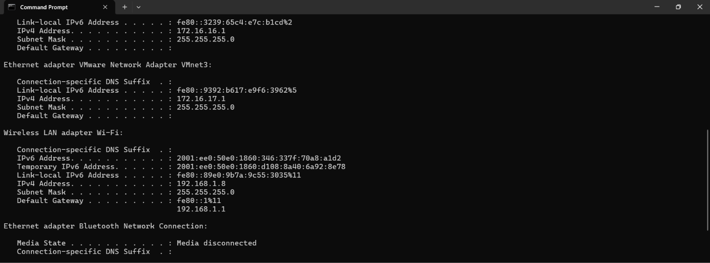

*Hình 2 – `ipconfig` ban đầu: VMnet2, VMnet3 nằm trong dải 172.16.0.0/16.*

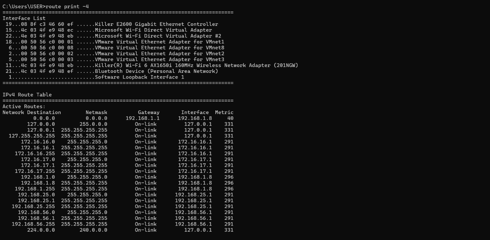

*Hình 3 – Bảng định tuyến `route print -4` của máy thật trước khi chỉnh.*

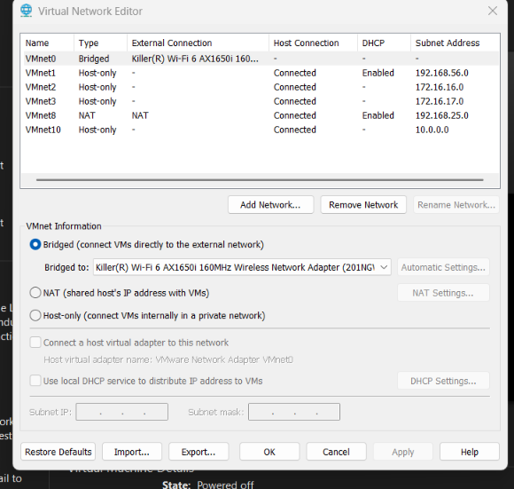

*Hình 4 – Virtual Network Editor: VMnet0 Bridged vào Wi-Fi, VMnet10 Host-only 10.0.0.0/8.*

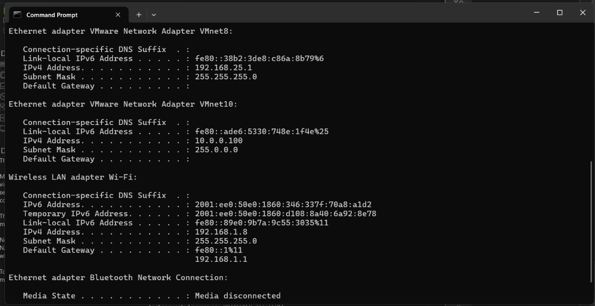

*Hình 5 – Card VMnet10 của máy thật là 10.0.0.100/8 (VMnet2, VMnet3 đã tắt).*

### 4.2. Tạo máy ảo pfSense và kiểm tra bộ cài

**Thực hiện** (mục B.1 trong báo cáo):

1. *File → New Virtual Machine → Typical*, chọn file ISO pfSense, hệ điều hành *Other → FreeBSD 14 64-bit*, tên máy ảo `pfSense-LAB5`, lưu tại `D:\Virtual Machines\pfSense-LAB5`.
2. Phần cứng: RAM 1 GB, 2 vCPU, ổ đĩa 20 GB.
3. Ba card mạng: Network Adapter 1 = **Bridged** (WAN), Network Adapter 2 = **Custom VMnet10** (LAN), Network Adapter 3 = **LAN segment dmz-net** (DMZ).
4. Trước khi giải nén bộ cài, kiểm tra SHA-256 của `pfSense-CE-2.7.2-RELEASE-amd64.iso.gz` bằng `Get-FileHash`.

**Kết quả:** máy ảo có đủ 3 card đúng vai trò (ở danh sách thiết bị bên trái các hình còn thấy Memory 1 GB, Processors 2 và ổ CD/DVD đang gắn ISO). Mã SHA-256 khớp giá trị `883fb7bc…cd9e4` trong tài liệu.

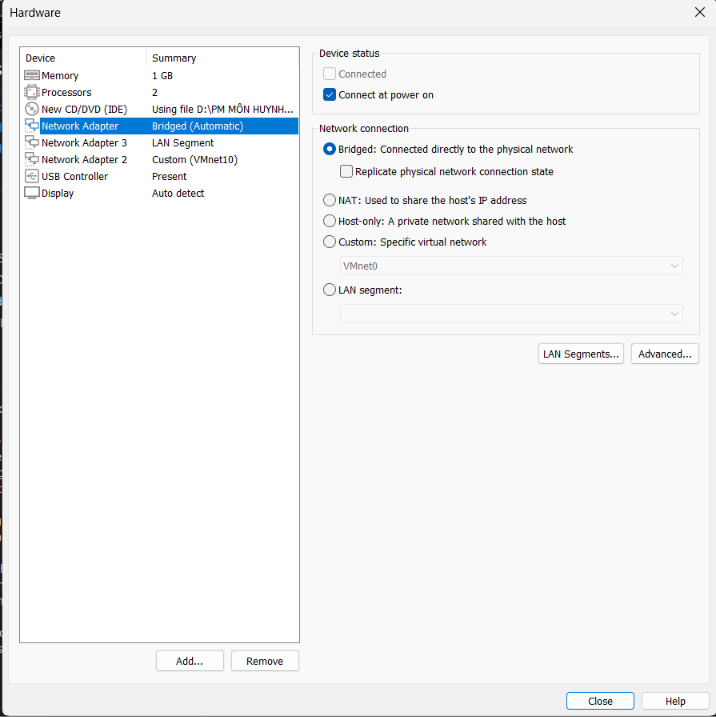

*Hình 6 – Network Adapter 1 – Bridged (WAN).*

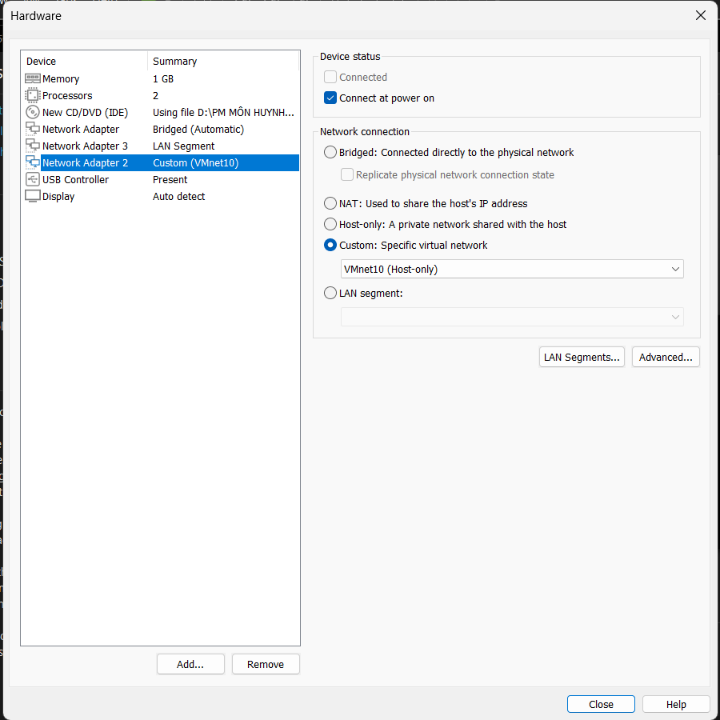

*Hình 7 – Network Adapter 2 – Custom VMnet10 (LAN).*

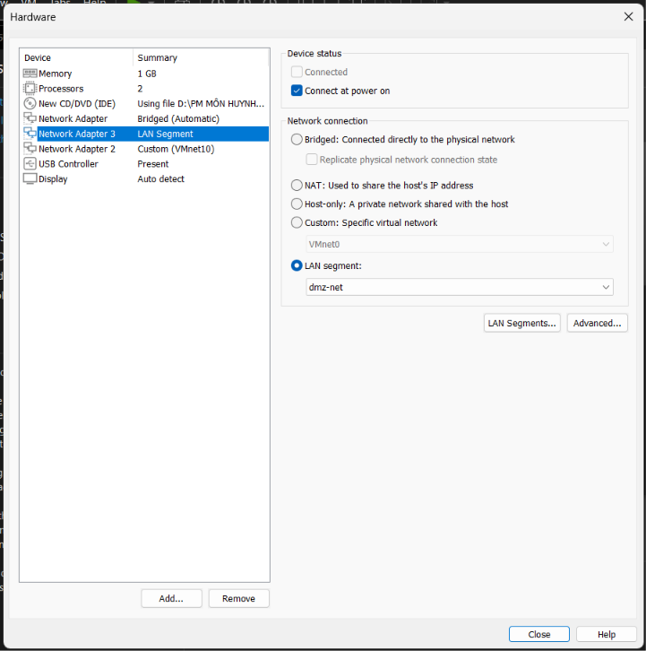

*Hình 8 – Network Adapter 3 – LAN segment dmz-net (DMZ).*

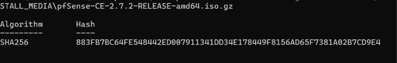

*Hình 9 – SHA-256 của file pfSense-CE-2.7.2-RELEASE-amd64.iso.gz khớp với giá trị công bố.*

### 4.3. Cài đặt pfSense

**Thực hiện** (mục B.2 trong báo cáo): khởi động máy ảo, trình cài đặt chọn *Accept → Install → giữ keymap mặc định → Auto (ZFS) → stripe → ổ da0 → YES*. Cài xong chọn Reboot, đồng thời *VM → Removable Devices → CD/DVD → Disconnect* và bỏ tick *Connect at power on* để máy không boot lại vào trình cài đặt.

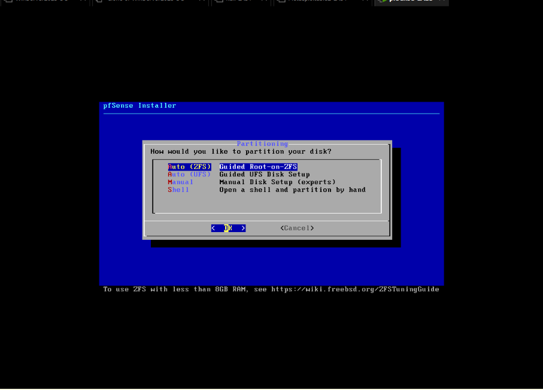

*Hình 10 – Trình cài đặt pfSense, bước chọn kiểu phân vùng Auto (ZFS).*

### 4.4. Gán interface và đặt IP LAN trên console

**Thực hiện** (mục B.3 trong báo cáo):

1. Lần khởi động đầu, pfSense tự gán WAN = em0 (nhận 192.168.1.2 từ modem) và LAN = em1 với IP mặc định 192.168.1.1/24, trùng dải với WAN.
2. Vào **1) Assign Interfaces**, đối chiếu MAC với ba card trong VMware: em0 = `00:0c:29:67:09:51` (Bridged), em1 = `00:0c:29:67:09:5b` (VMnet10), em2 = `00:0c:29:67:09:65` (dmz-net). Gán WAN = em0, LAN = em1, DMZ để gán sau trên WebGUI. Vai trò được xác định bằng MAC, không dựa vào tên card.
3. Vào **2) Set interface(s) IP address → 2 (LAN)**: không dùng DHCP, nhập `10.0.0.1` với subnet bit count `8`, không gateway, không IPv6, không bật DHCP server, giữ HTTPS cho WebGUI.

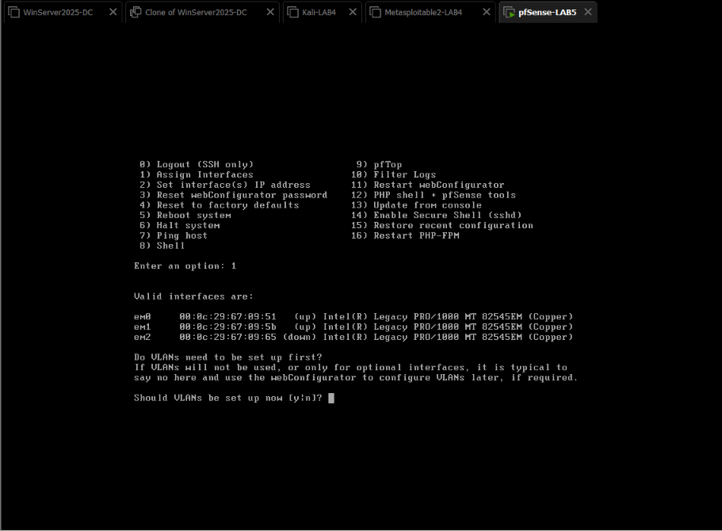

*Hình 11 – Console pfSense liệt kê em0/em1/em2 kèm địa chỉ MAC.*

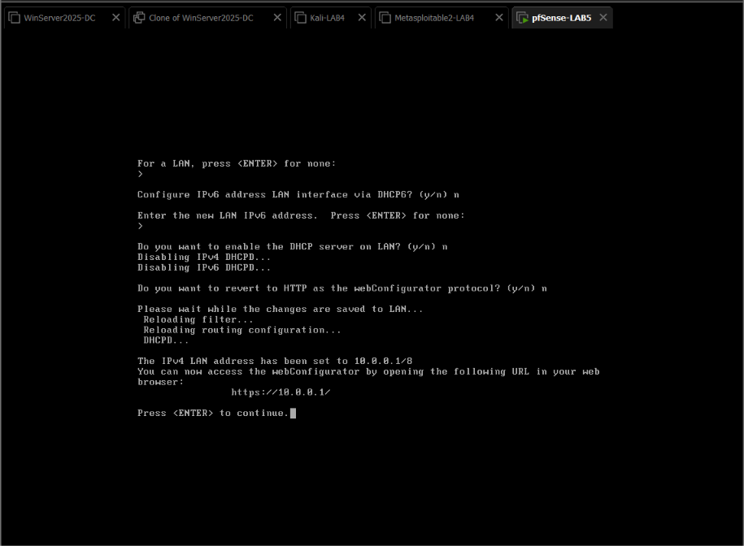

*Hình 12 – Đặt địa chỉ LAN 10.0.0.1/8 trên console.*

### 4.5. Dựng Domain Controller vietnam.local

**Thực hiện** (mục B.4 trong báo cáo):

1. Chuyển card mạng của VM `WinServer2025-DC` sang VMnet10. Kiểm tra `(Get-CimInstance Win32_ComputerSystem).DomainRole` = 2 (server độc lập, chưa phải DC).
2. Đặt IP tĩnh: `10.0.0.2 / 255.0.0.0`, gateway `10.0.0.1`, Preferred DNS `10.0.0.2`. Sau đó ping thử 10.0.0.1 và 8.8.8.8 (lúc này LAN vẫn còn rule Default allow của pfSense).
3. *Add Roles and Features* → **Active Directory Domain Services**.
4. Promote thành Domain Controller: *Add a new forest*, root domain `vietnam.local`, NetBIOS `VIETNAM`, đặt mật khẩu DSRM → Install. Máy tự khởi động lại, đăng nhập bằng `VIETNAM\Administrator`.
5. *DNS Manager → Properties → Forwarders*: thêm `8.8.8.8`. Card mạng của DC vẫn giữ Preferred DNS = 10.0.0.2.
6. Kiểm tra tách riêng kết nối IP (`ping 8.8.8.8`) và phân giải DNS (`Resolve-DnsName example.com`).

**Kết quả:** DC ping được pfSense và Internet; sau khi lên DC và cấu hình forwarder, cả `ping 8.8.8.8` và `Resolve-DnsName example.com` đều thành công.

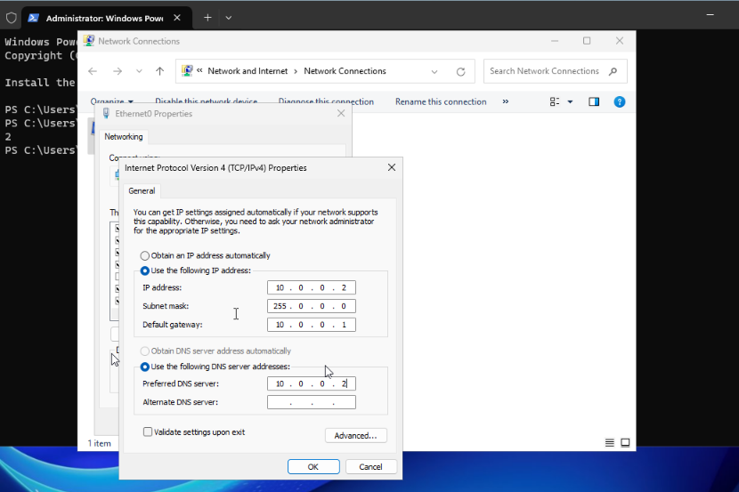

*Hình 13 – Cấu hình IPv4 cho Windows Server (DC).*

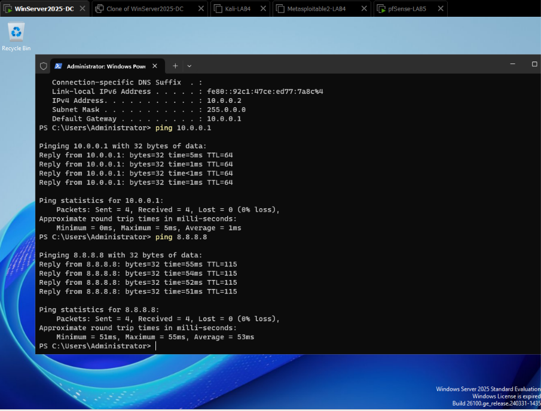

*Hình 14 – DC ping tới pfSense và ra Internet sau khi đặt IP.*

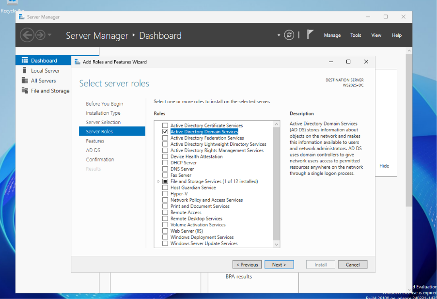

*Hình 15 – Chọn Active Directory Domain Services trong Add Roles and Features.*

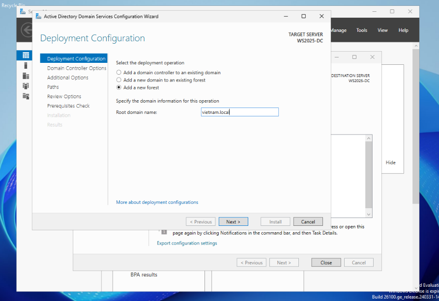

*Hình 16 – Tạo forest mới vietnam.local.*

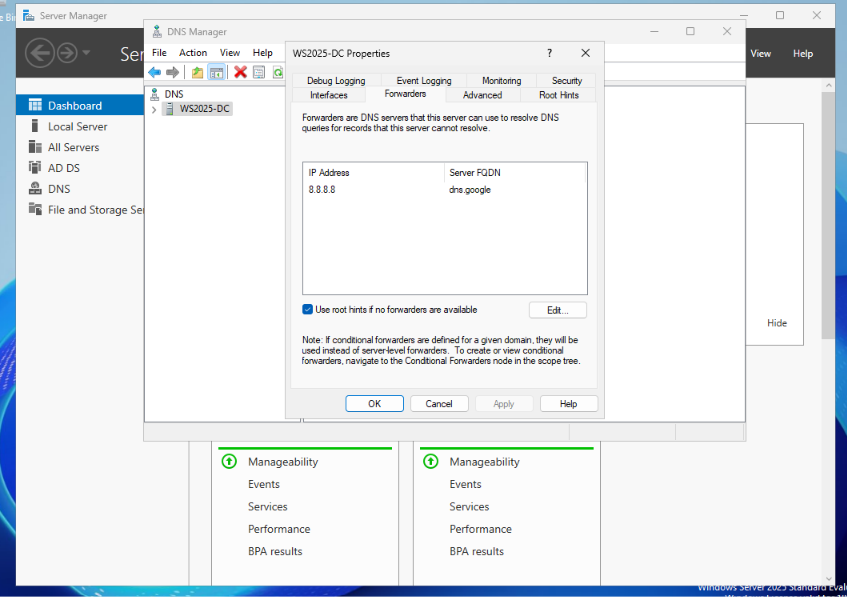

*Hình 17 – DNS Forwarder 8.8.8.8 trên Domain Controller.*

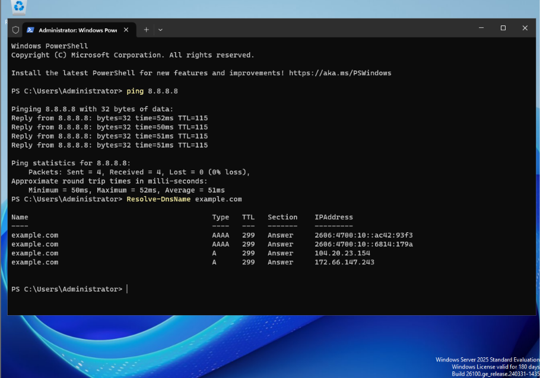

*Hình 18 – DC ping 8.8.8.8 và phân giải example.com thành công.*

### 4.6. Truy cập WebGUI và chạy Setup Wizard

**Thực hiện** (mục B.5 trong báo cáo):

1. Từ máy thật (card VMnet10 = 10.0.0.100/8) ping `10.0.0.1`: nhận đủ 4 reply, **TTL = 64** → card VMnet10 nối đúng vào em1 (LAN).
2. Mở trình duyệt vào `https://10.0.0.1`. Chrome báo chứng chỉ không an toàn vì pfSense dùng chứng chỉ tự ký → *Advanced → Proceed*, đăng nhập tài khoản mặc định admin.
3. Setup Wizard: hostname `pfSense-1150080095`, Primary DNS 8.8.8.8, múi giờ Asia/Ho_Chi_Minh, WAN để DHCP, LAN `10.0.0.1/8`, **đổi mật khẩu admin**.

**Kết quả:** Dashboard hiển thị đúng phiên bản **2.7.2-RELEASE**, tên máy `pfSense-1150080095.home.arpa`; WAN nhận 192.168.1.2 từ modem qua Bridged, LAN là 10.0.0.1.

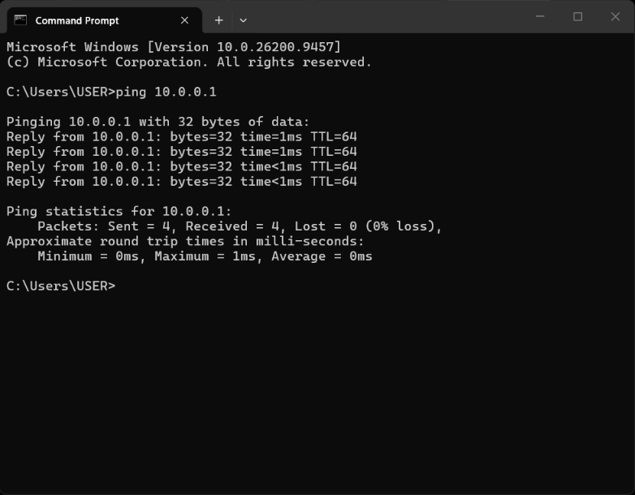

*Hình 19 – Ping từ máy thật đến pfSense 10.0.0.1.*

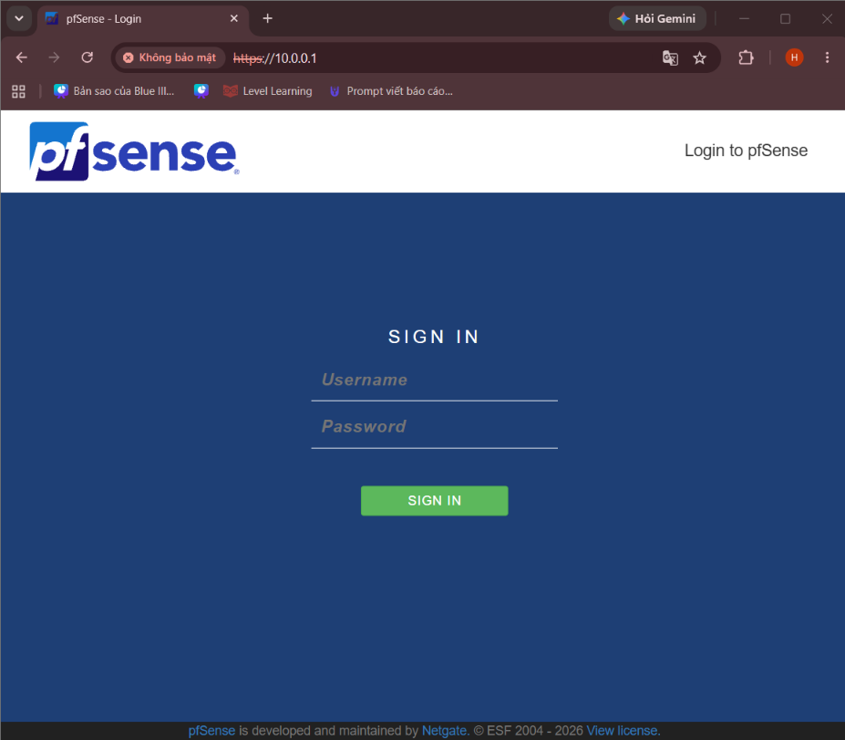

*Hình 20 – Trang đăng nhập pfSense.*

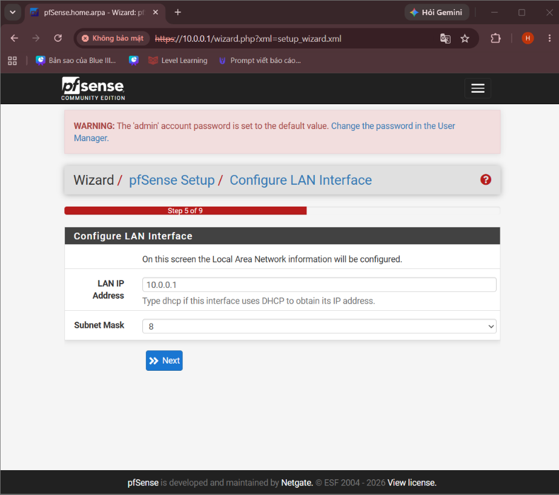

*Hình 21 – Setup Wizard, cấu hình LAN 10.0.0.1/8.*

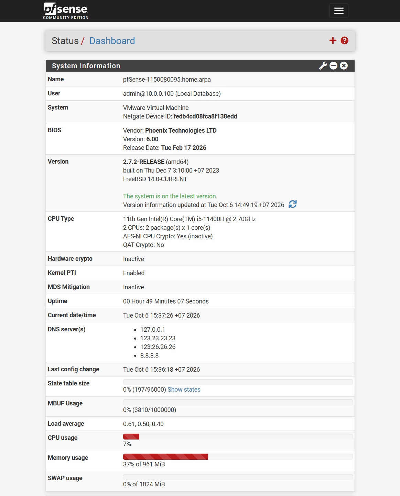

*Hình 22 – Dashboard của pfSense: System Information (2.7.2-RELEASE, pfSense-1150080095.home.arpa).*

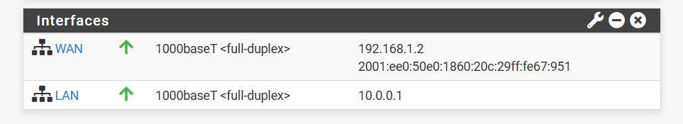

*Hình 23 – Dashboard của pfSense: trạng thái interface WAN và LAN.*

### 4.7. Cấu hình vùng DMZ và máy DMZ-Web

**Thực hiện** (mục B.6 trong báo cáo):

1. *Interfaces → Assignments*: card em2 có MAC `00:0c:29:67:09:65` (đúng Network Adapter 3 – dmz-net) → **Add** thành OPT1 → Save.
2. *Interfaces → OPT1*: Enable, Description = **DMZ**, IPv4 = Static `172.16.0.1/16`, IPv6 = None, IPv4 Upstream gateway = None.
3. Tạo máy **DMZ-Web** từ bản clone Windows Server 2025 mới cài (chưa promote, không join domain), RAM 2 GB, card mạng nối LAN segment `dmz-net`. IP `172.16.0.2/16`, gateway `172.16.0.1`, DNS để trống vì DMZ chưa có rule Pass ra Internet.
4. Cài IIS bằng PowerShell quyền Administrator: `Install-WindowsFeature Web-Server -IncludeManagementTools`; tạo trang `index.html` có tên và MSSV; kiểm tra bằng `curl.exe http://localhost`.

**Kết quả:** cài IIS trả về *Success = True*; `curl.exe http://localhost` trả về đúng trang web. (Lúc đầu gõ nhầm `https://localhost` nên báo không kết nối được cổng 443, vì IIS mặc định chỉ chạy HTTP cổng 80.)

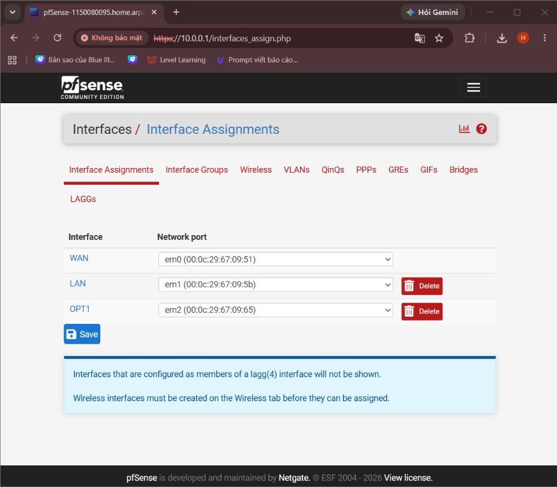

*Hình 24 – Gán card mạng thứ ba (em2) thành OPT1.*

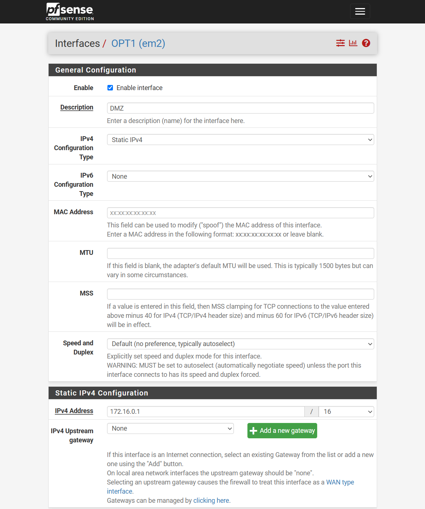

*Hình 25 – Cấu hình interface DMZ 172.16.0.1/16.*

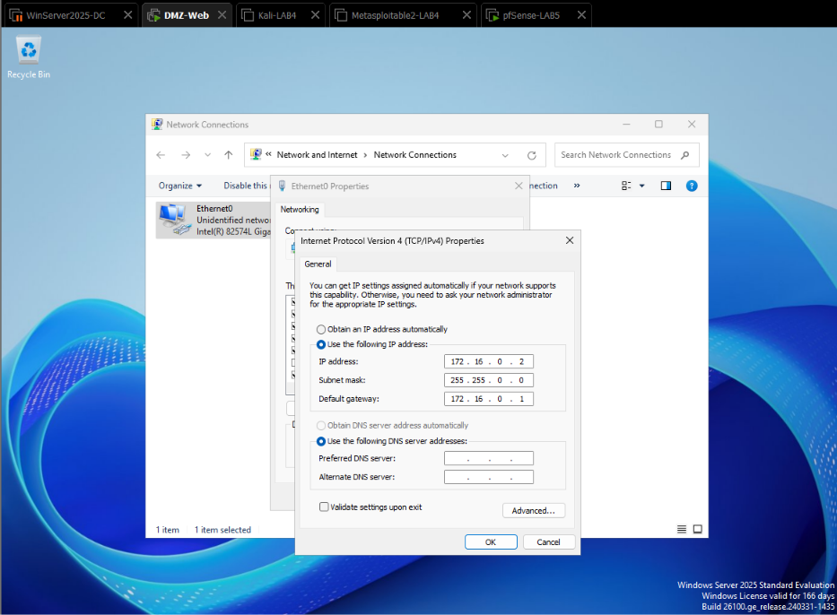

*Hình 26 – Cấu hình IPv4 cho máy DMZ-Web.*

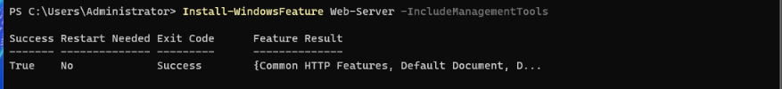

*Hình 27 – Cài đặt IIS trên DMZ-Web: Success = True.*

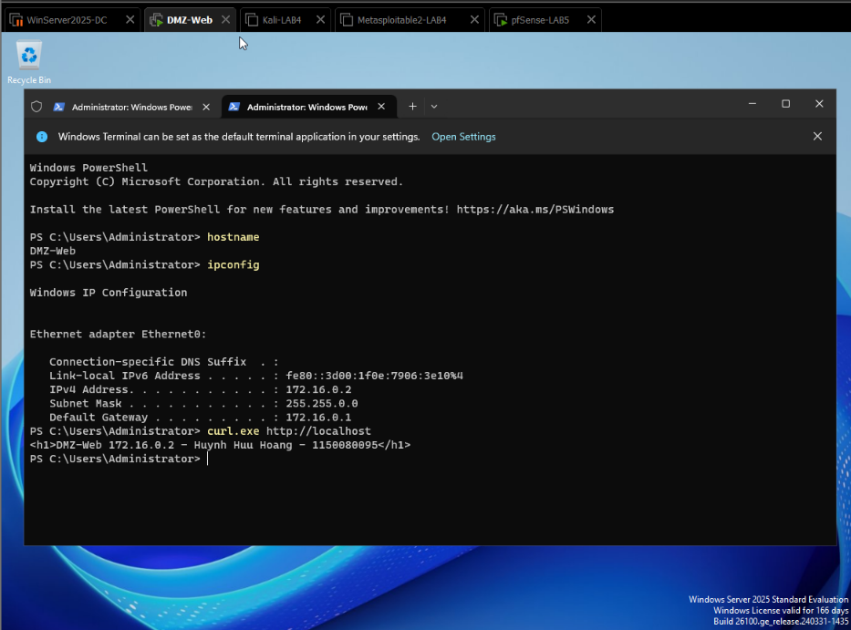

*Hình 28 – Tên máy, địa chỉ IP và trang web IIS trên DMZ-Web.*

### 4.8. Kiểm tra Outbound NAT tự động

**Thực hiện** (mục B.7 trong báo cáo): *Firewall → NAT → Outbound*, chọn **Hybrid Outbound NAT rule generation** → Save → Apply Changes, rồi quan sát vùng Automatic Rules.

**Kết quả:** pfSense tự sinh rule NAT trên WAN với nguồn gồm 127.0.0.0/8, ::1/128, **10.0.0.0/8 (LAN)** và **172.16.0.0/16 (DMZ)**, NAT Address là WAN address → không cần tạo manual Outbound NAT. Tuy vậy DMZ vẫn chưa ra được Internet vì tab *Firewall → Rules → DMZ* chưa có rule Pass nào (interface mới thêm mặc định bị chặn hết).

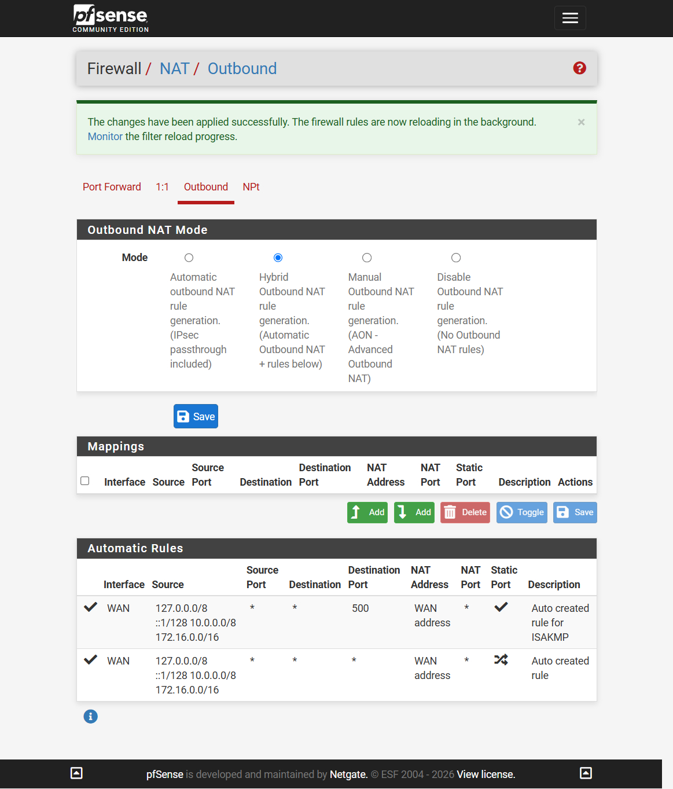

*Hình 29 – Outbound NAT ở chế độ Hybrid và các Automatic Rules cho LAN, DMZ.*

### 4.9. Chuẩn hóa ruleset LAN và tạo rule nền tảng

**Thực hiện** (mục B.8 trong báo cáo):

1. *Firewall → Rules → LAN*: **Disable** cả hai rule *Default allow LAN to any* (IPv4 và IPv6), giữ nguyên Anti-Lockout Rule để máy thật vẫn vào được WebGUI → Apply Changes.
2. *Diagnostics → States → Reset States*: tick *Reset the firewall state table* → Reset, để kết nối cũ không còn được giữ bởi state tạo trước khi đổi ruleset.
3. Tạo rule nền tảng:

   | Action | Protocol | Source | Destination | Mục đích |
   | :-- | :-- | :-- | :-- | :-- |
   | Pass | Any | LAN net | Any | Rule nền tảng do sinh viên quản lý |

4. *Diagnostics → Ping* tới 8.8.8.8 để kiểm tra đường ra Internet của chính pfSense.

**Kết quả:** bản 2.7.2 hiển thị Source là *LAN subnets*, chính là LAN net trong tài liệu. Lúc đầu chỉ bấm Save mà quên Apply Changes (thanh vàng ở đầu Hình 32) nên DC chưa ra được Internet; sau khi Apply thì rule mới có hiệu lực. pfSense ping 8.8.8.8 nhận 3/3 gói, 0% packet loss. Phép thử này chỉ chứng minh pfSense ra được Internet; gói không đi qua rule tab LAN nên rule được kiểm tra riêng ở mục 4.10.

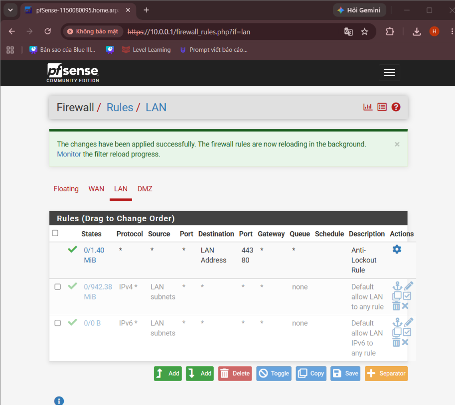

*Hình 30 – Hai rule Default allow LAN to any đã bị Disable.*

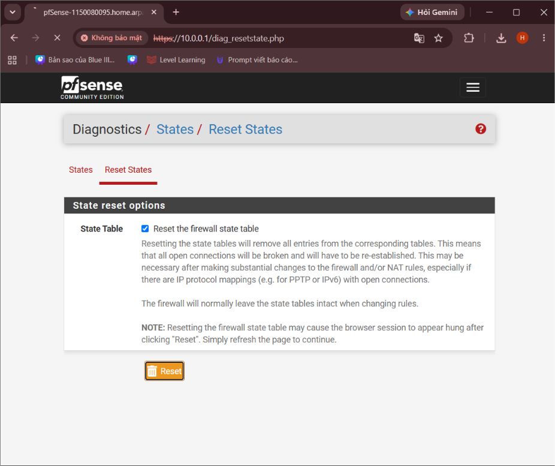

*Hình 31 – Reset firewall state table.*

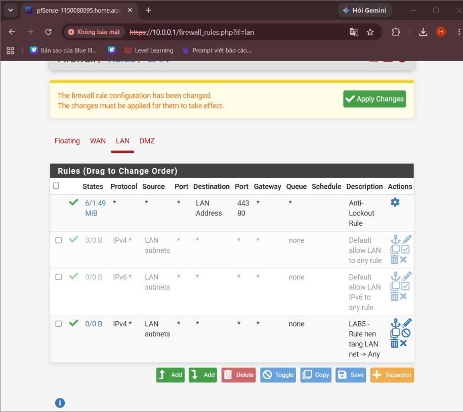

*Hình 32 – Rule nền tảng “LAB5 - Rule nen tang LAN net -> Any” trên tab LAN.*

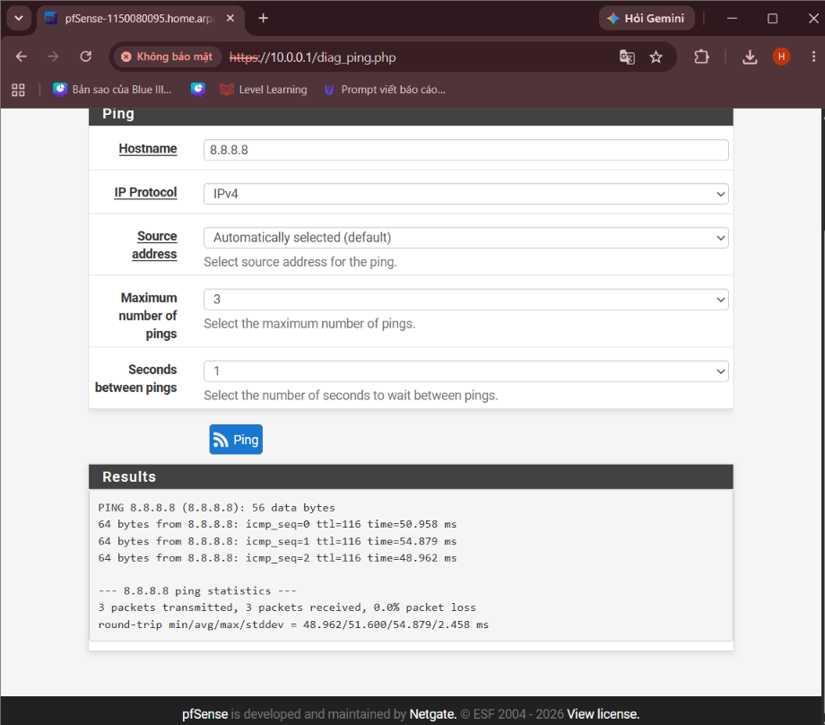

*Hình 33 – pfSense ping 8.8.8.8 thành công.*

### 4.10. Kiểm thử rule nền tảng từ Domain Controller

**Thực hiện** (mục B.9 trong báo cáo):

1. **Rule nền tảng đang bật:** trên DC chạy `ping 8.8.8.8` và `curl.exe -4 https://example.com`.
2. **Tắt rule nền tảng:** Disable rule → Apply Changes. Lúc này trên tab LAN cả hai rule Default allow lẫn rule nền tảng đều Disabled, chỉ còn Anti-Lockout Rule.
3. **Reset States** (như Hình 31) rồi chạy một lệnh `ping 8.8.8.8` mới trên DC.

**Kết quả:**

| Trạng thái rule nền tảng | `ping 8.8.8.8` từ DC | `curl.exe -4 https://example.com` |
| :-- | :-- | :-- |
| Enabled | Thông | Trả về trang *Example Domain* |
| Disabled + Reset States | 4/4 *Request timed out*, **100% loss** | – |

Kết quả chứng minh lưu lượng của DC ra Internet phụ thuộc trực tiếp vào rule nền tảng do sinh viên tạo, không còn dựa vào rule Default allow. (Trong Hình 34 có lệnh gõ nhầm `Resolve-DnsName examle.com` nhưng vẫn phân giải ra địa chỉ; phép thử đúng với example.com đã có ở Hình 18.)

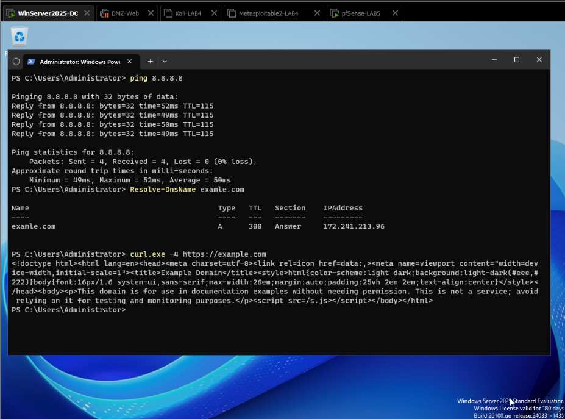

*Hình 34 – DC ra Internet được khi rule nền tảng đang bật.*

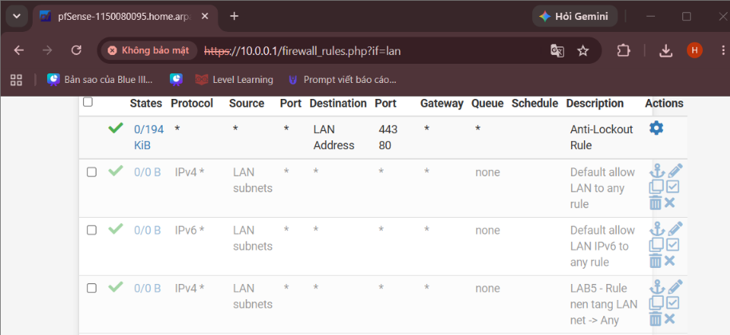

*Hình 35 – Tab LAN: hai rule Default allow và rule nền tảng đều Disabled.*

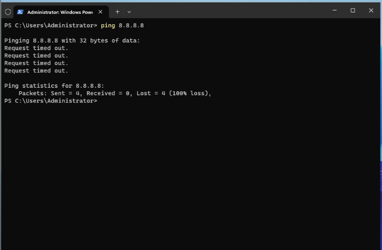

*Hình 36 – DC không ra được Internet sau khi tắt rule nền tảng và xóa state (100% loss).*

### 4.11. Máy LAN-Test

Theo tài liệu, LAN-Test là host thứ hai trong LAN, dùng cho tình huống chỉ cho một host cụ thể ra Internet. Trong bài này **chưa dựng** máy LAN-Test (máy thật chỉ có 8 GB RAM); báo cáo (mục B.10) trình bày cấu hình dự kiến và lý do chọn:

- Cấu hình dự kiến: Ubuntu Server LTS bản minimal, RAM 1 GB, một card nối VMnet10, IP `10.0.0.3/8`, gateway `10.0.0.1`.
- Không dùng máy thật 10.0.0.100 làm host thứ hai vì card VMnet10 không có default gateway về pfSense; máy thật ra Internet qua Wi-Fi nên phép thử không chứng minh được gì.
- Không clone trực tiếp VM Domain Controller vì bản clone mang theo vai trò DC, SID và dữ liệu AD, dễ gây xung đột.

## 5. Trả lời câu hỏi

Tóm tắt câu trả lời; bản đầy đủ nằm ở mục D của file báo cáo.

<details>
<summary>6 câu hỏi mục D</summary>

1. **NAT và firewall rule:** NAT đổi địa chỉ và cổng (Outbound NAT ở Hình 29 đổi nguồn LAN 10.0.0.0/8 và DMZ 172.16.0.0/16 thành WAN 192.168.1.2; Port Forward đổi đích từ WAN vào máy bên trong). Rule quyết định gói vào interface được cho qua hay bị chặn. NAT không tự cho phép lưu lượng: DMZ có NAT nhưng chưa có rule Pass vẫn không ra được; tắt rule nền tảng thì DC bị chặn dù NAT còn nguyên (Hình 36).
2. **Tách Web/Mail/FTP vào DMZ:** các dịch vụ này mở cho bên ngoài nên dễ bị tấn công nhất. Nếu đặt trong LAN, khi bị chiếm quyền thì kẻ tấn công đứng ngay cạnh Domain Controller và máy trạm. Tách ra DMZ thì có firewall ở giữa: chặn DMZ → LAN, từ WAN chỉ mở đúng cổng dịch vụ, log riêng từng vùng, thiệt hại chỉ nằm trong DMZ.
3. **Block nằm dưới Pass tổng quát:** pfSense xét rule từ trên xuống và dừng ở rule khớp đầu tiên, nên Pass LAN net → Any khớp trước, rule Block bên dưới không bao giờ được xét và lưu lượng lẽ ra bị chặn vẫn đi được. Rule Block cụ thể phải đặt trên rule Pass rộng hơn.
4. **Chặn ping nhưng vẫn cho web:** Disable rule Pass LAN net → Any, rồi tạo theo thứ tự: Block ICMP LAN net → Any; Pass TCP/UDP cổng 53 (DNS); Pass TCP cổng 80, 443. Lưu lượng còn lại bị chặn mặc định. Sau khi Apply Changes cần Reset States.
5. **Vai trò của logging:** log cho biết gói nào bị chặn hay được cho qua, ở interface nào, nguồn, đích, cổng, giao thức, thời điểm và rule nào xử lý → biết ngay lỗi do firewall hay do DNS, máy đích, Windows Firewall; giúp phát hiện dò quét và làm bằng chứng sau sự cố; có thể đối chiếu với *Diagnostics → States*.
6. **Hardening pfSense:** đổi mật khẩu admin mặc định (đã đổi trong Setup Wizard); chỉ cho vào WebGUI qua HTTPS từ máy quản trị 10.0.0.100, không mở WebGUI/SSH trên WAN; bỏ rule allow any, Block đặt trên Pass; bật Block private và bogon networks trên WAN khi ra Internet thật; cập nhật phiên bản mới; bật log, gửi về syslog, đồng bộ NTP và sao lưu cấu hình định kỳ.

</details>

## 6. Mức độ hoàn thành

| Phần | Trạng thái |
| :-- | :-- |
| A. Tổng quan: ánh xạ mạng VMware, bảng IP, kiểm tra trùng dải, phân bổ tài nguyên | Đã làm, có ảnh minh chứng |
| B.1 – B.9: tạo VM, cài pfSense, console, Domain Controller, WebGUI, DMZ, Outbound NAT, ruleset LAN, kiểm thử bật/tắt rule | Đã làm, có ảnh minh chứng (35 ảnh) |
| B.10: máy LAN-Test | Chưa dựng máy; báo cáo trình bày cấu hình dự kiến |
| C: 5 tình huống firewall | Chưa thực hiện |
| D: 6 câu hỏi | Đã trả lời |

## 7. Cấu trúc thư mục

```
Lab05_AT-BMHTTT/
├── README.md                                     # tệp này
├── 11CNPM2-LAB5_1150080095-HuynhHuuHoang.docx    # báo cáo chính
└── images/                                       # 35 ảnh minh chứng (Hình 2 – 36, trích từ báo cáo)
```

## 8. Ghi chú

- Tài liệu hướng dẫn viết cho VirtualBox; bài làm dùng VMware Workstation với mạng tương đương (Bridged, Host-only VMnet10, LAN segment `dmz-net`).
- Dùng Windows Server 2025 thay cho 2019/2022 (thao tác AD DS, DNS, IIS giống nhau). pfSense cấp 1 GB RAM thay vì 2 GB do máy thật chỉ có 8 GB.
- pfSense CE 2.7.2 là bản cũ, chỉ dùng trong mạng lab ảo hóa, cô lập; trong lab tạm Disable hai card VMnet2/VMnet3 của máy thật để tránh trùng dải DMZ.
- Phạm vi: chỉ cấu hình trên các máy ảo do chính sinh viên dựng, phục vụ học tập và nghiên cứu, không nhằm mục đích phá hoại.
